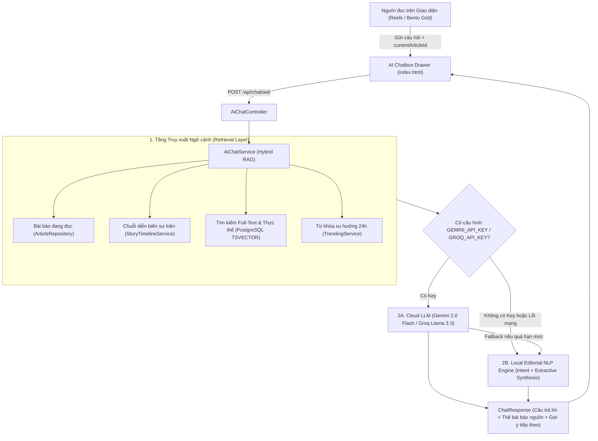

# Kế Hoạch & Kiến Trúc Tích Hợp AI Chatbox (VNNews AI Assistant)

## 1. Tổng quan & Mục tiêu
**VNNews AI Assistant** là trợ lý đọc báo thông minh tích hợp trực tiếp vào nền tảng **VNNews Hub**, được thiết kế theo kiến trúc **Hybrid RAG (Retrieval-Augmented Generation)**:

1. **Chạy ngay không cần cấu hình (Zero-Config Local RAG Engine):** Tận dụng trực tiếp kho dữ liệu bài viết trong PostgreSQL, bộ trích xuất thực thể [`VietnameseKeywordExtractor`](src/main/java/com/khanh/newsaggregator/trending/VietnameseKeywordExtractor.java), dòng sự kiện [`StoryTimelineService`](src/main/java/com/khanh/newsaggregator/article/StoryTimelineService.java) và xu hướng [`TrendingService`](src/main/java/com/khanh/newsaggregator/trending/TrendingService.java) để phân tích ý định (Intent Detection) và tổng hợp câu trả lời tức thì (< 50ms) mà không bắt buộc phải có API Key bên ngoài.
2. **Hỗ trợ kết nối Cloud LLM miễn phí (Google Gemini / Groq Cloud):** Khi cấu hình biến môi trường `GEMINI_API_KEY` hoặc `GROQ_API_KEY` trên Render/Local, hệ thống tự động kích hoạt mô hình ngôn ngữ lớn (`gemini-2.0-flash` hoặc `llama-3.3-70b-versatile`) kết hợp ngữ cảnh bài báo thực tế trong DB để trả lời tự nhiên như một biên tập viên báo chí.
3. **Nhận diện ngữ cảnh bài đang đọc (Context-Aware Reading):** Tự động nhận biết người dùng đang dừng ở thẻ tin nào trên giao diện Reels hoặc đang lọc chuyên mục nào để hỗ trợ giải thích bối cảnh, tóm tắt cốt lõi và xâu chuỗi sự kiện chỉ với 1 chạm.
4. **Giao diện Dịu mắt (Eye-Friendly Editorial UI):** Đồng bộ 100% với hệ thống CSS Design Tokens (**Warm Graphite** ở Nền tối và **Warm Newsprint Paper** ở Nền sáng), không dùng hiệu ứng nhấp nháy gây mỏi mắt, tương thích hoàn hảo trên cả máy tính và điện thoại.

---

## 2. Kiến trúc Luồng Xử lý (Hybrid RAG Pipeline)



---

## 3. Thiết kế Chi tiết Backend (`com.khanh.newsaggregator.chat`)

### 3.1. Cấu trúc Package & Các Class mới
* [`src/main/java/com/khanh/newsaggregator/chat/dto/ChatRequest.java`](src/main/java/com/khanh/newsaggregator/chat/dto/ChatRequest.java)
  * `message` (`String`): Câu hỏi hoặc yêu cầu của người dùng.
  * `currentArticleId` (`Long`, tùy chọn): ID bài báo người dùng đang xem trên màn hình.
  * `categoryId` (`Long`, tùy chọn): ID chuyên mục người dùng đang lọc.
* [`src/main/java/com/khanh/newsaggregator/chat/dto/ChatArticleRef.java`](src/main/java/com/khanh/newsaggregator/chat/dto/ChatArticleRef.java)
  * Thông tin rút gọn của bài báo đính kèm câu trả lời (`id`, `title`, `sourceName`, `categoryName`, `url`, `publishedAt`).
* [`src/main/java/com/khanh/newsaggregator/chat/dto/ChatResponse.java`](src/main/java/com/khanh/newsaggregator/chat/dto/ChatResponse.java)
  * `reply` (`String`): Nội dung câu trả lời đã định dạng biên tập.
  * `engine` (`String`): Chế độ phản hồi (`GEMINI`, `GROQ`, hoặc `LOCAL_EDITORIAL`).
  * `relatedArticles` (`List<ChatArticleRef>`): Danh sách bài viết dẫn chứng có thật trong DB.
  * `suggestedPrompts` (`List<String>`): Các câu hỏi gợi ý thông minh tiếp theo.
* [`src/main/java/com/khanh/newsaggregator/chat/AiChatService.java`](src/main/java/com/khanh/newsaggregator/chat/AiChatService.java)
  * **Retrieval (Truy xuất ngữ cảnh):**
    * Nếu có `currentArticleId`, lấy thông tin chi tiết bài viết và gọi `storyTimelineService.getTimelineForArticle(currentArticleId)` để lấy mạch sự kiện (Khởi nguồn -> Diễn biến -> Mới nhất).
    * Phân tích câu hỏi của người dùng để nhận diện 5 nhóm ý định (Intents):
      1. `CURRENT_ARTICLE`: Tóm tắt, phân tích hoặc giải thích bài báo đang xem.
      2. `TIMELINE_ARC`: Hỏi về nguồn gốc, diễn biến trước/sau của sự kiện.
      3. `HOT_BRIEFING`: Điểm tin nóng, tin nổi bật mới nhất hôm nay.
      4. `TRENDING_TOPICS`: Hỏi về các từ khóa/chủ đề đang được quan tâm nhất.
      5. `TOPIC_SEARCH`: Tìm kiếm và tổng hợp tin tức theo từ khóa hoặc chủ đề cụ thể.
  * **Generation (Tổng hợp phản hồi):**
    * Sử dụng `java.net.http.HttpClient` chuẩn của Java 21 để gọi Gemini API (`https://generativelanguage.googleapis.com/v1beta/models/gemini-2.0-flash:generateContent`) hoặc Groq API (`https://api.groq.com/openai/v1/chat/completions`) khi có biến môi trường `GEMINI_API_KEY` hoặc `GROQ_API_KEY`.
    * Nếu không cấu hình API Key (hoặc API trả lỗi/timeout), hệ thống tự động chuyển sang **Local Editorial Synthesis** để biên tập bản tóm tắt đa nguồn từ dữ liệu thực trong PostgreSQL.
* [`src/main/java/com/khanh/newsaggregator/chat/AiChatController.java`](src/main/java/com/khanh/newsaggregator/chat/AiChatController.java)
  * `POST /api/chat/ask`: Xử lý câu hỏi và trả về `ApiResponse<ChatResponse>`.
  * `GET /api/chat/status`: Trả về trạng thái hoạt động của trợ lý AI và các gợi ý mở đầu.

### 3.2. Cấu hình Bảo mật & Tham số (`SecurityConfig.java` & `application.yml`)
* Mở quyền truy cập công khai (`permitAll()`) cho `/api/chat/**` trong [`SecurityConfig.java`](src/main/java/com/khanh/newsaggregator/auth/SecurityConfig.java) để mọi độc giả (kể cả chưa đăng nhập) đều có thể sử dụng trợ lý đọc báo.
* Bổ sung cấu hình `news.ai` trong [`application.yml`](src/main/resources/application.yml):
  ```yaml
  news:
    ai:
      gemini-api-key: ${GEMINI_API_KEY:}
      gemini-model: ${GEMINI_MODEL:gemini-2.0-flash}
      groq-api-key: ${GROQ_API_KEY:}
      groq-model: ${GROQ_MODEL:llama-3.3-70b-versatile}
  ```

---

## 4. Thiết kế Giao diện Frontend (`src/main/resources/static/index.html`)

1. **Nút Trợ lý AI Nổi (Floating Trigger Button):**
   * Đặt tại góc dưới bên phải màn hình (`bottom-20 md:bottom-6 right-4 md:right-6`), tự động tránh thanh điều hướng di động `mobileBottomNav`.
   * Thiết kế tối giản, sang trọng theo phong cách báo chí, sử dụng biến màu `var(--bg-surface-elevated)`, `var(--border-strong)` và điểm nhấn `var(--accent-editorial)`.
2. **Khung Trò chuyện Trợ lý Báo chí (Editorial AI Chat Drawer):**
   * **Header:** Hiển thị tên **"Trợ lý Điểm tin AI"**, trạng thái động cơ (`Editorial RAG` / `Gemini AI`), nút làm mới hội thoại và nút đóng.
   * **Thanh Ngữ cảnh Bài đang đọc (`#aiContextBanner`):** Tự động cập nhật tiêu đề bài viết mà người dùng đang dừng ở chế độ Reels (hoặc đang xem), cho phép hỏi ngay về bài viết đó mà không cần gõ lại tiêu đề.
   * **Khung Tin nhắn (`#aiChatMessages`):**
     * Hiển thị bong bóng hội thoại có độ tương phản dịu mắt (`var(--bg-surface-elevated)`, `var(--text-primary)`).
     * Dưới mỗi câu trả lời có danh sách **Thẻ bài báo dẫn chứng** (bấm vào sẽ mở xem toàn văn hoặc xem dòng thời gian sự kiện ngay trên trang).
   * **Dãy Chip Gợi ý Nhanh (`#aiQuickPrompts`):**
     * *"Tóm tắt tin đang xem"*
     * *"Diễn biến sự kiện này"*
     * *"Điểm 5 tin nóng nhất"*
     * *"Chủ đề xu hướng hôm nay"*
3. **Tích hợp Nút "Hỏi AI" trên Thẻ bài viết:**
   * Cho phép người dùng bấm trực tiếp từ hộp thoại xem trước bài báo hoặc thanh công cụ để mở nhanh Chatbox kèm phân tích sâu về bài báo đó.

---

## 5. Kế hoạch Triển khai & Kiểm thử
- [x] **Bước 1:** Lập tài liệu thiết kế kiến trúc [`AI_CHATBOX_PLAN.md`](AI_CHATBOX_PLAN.md).
- [x] **Bước 2:** Xây dựng các DTO (`ChatRequest`, `ChatResponse`, `ChatArticleRef`), Service (`AiChatService`) và Controller (`AiChatController`).
- [x] **Bước 3:** Cập nhật [`SecurityConfig.java`](src/main/java/com/khanh/newsaggregator/auth/SecurityConfig.java) và [`application.yml`](src/main/resources/application.yml).
- [x] **Bước 4:** Tích hợp giao diện AI Chatbox vào [`src/main/resources/static/index.html`](src/main/resources/static/index.html) đồng bộ cả 2 chế độ Nền Sáng / Nền Tối.
- [x] **Bước 5:** Viết Unit Test kiểm thử `AiChatServiceTest` và chạy `./mvnw.cmd test` xác nhận toàn bộ hệ thống hoạt động hoàn hảo.
